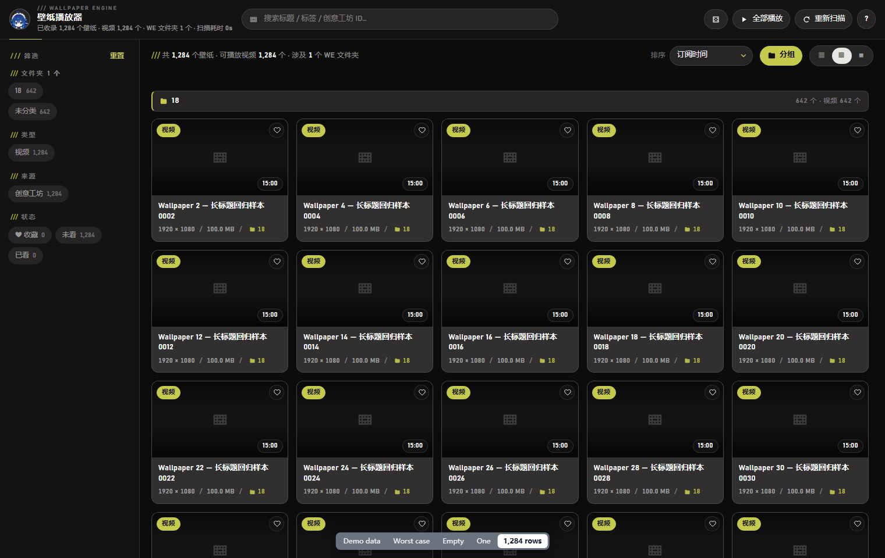

# WE 壁纸播放器



把 **Wallpaper Engine 里已经下载好的壁纸**（Steam 创意工坊 + 我的壁纸）自动整理成一个画廊，
点一下就能播放其中的视频壁纸 —— 不用再「右键 → 在资源管理器中打开 → 双击视频」。

- 自动找出所有 Steam 库（读注册表 + `libraryfolders.vdf`），无需手工填路径
- 自动读取每个壁纸的 `project.json`：标题、标签、分级、预览动画、视频文件
- **自动同步 Wallpaper Engine 里的文件夹**（含多层子文件夹），支持按文件夹分组显示、按文件夹筛选、按订阅时间排序
- **非视频壁纸（场景 / 网页）显示真实效果**：调用 Wallpaper Engine 自己的渲染器，把画面精确贴在播放器的画面区域上，而不是拿预览图糊弄
- 缩略图直接用官方预览（GIF 会动），悬停显示播放按钮
- 播放器带进度记忆、收藏、已看标记、播放列表连播、随机播放、倍速、全屏、画中画
- **零第三方依赖**：只用 Python 标准库 + 系统自带的 Chrome / Edge 内核解码视频

---

## 一、快速开始

双击目录里的 **`启动播放器.vbs`** 即可。

它会做三件事：

1. 扫描所有 Steam 库里的壁纸（第一次约 0.5 秒）；
2. 在本地 `127.0.0.1` 起一个只对本机开放的小服务；
3. 用 Chrome / Edge 的「应用窗口」模式打开播放器（没有地址栏，和普通软件窗口一样）。

> 想开机就用？右键 `启动播放器.vbs` → 发送到 → 桌面快捷方式。

**退出**：直接关闭窗口即可，后台服务会在窗口关闭后自动退出。
（想看运行日志或遇到问题，改用 `调试启动.bat`，日志写在 `data\player.log`。）

---

## 二、界面说明

### 画廊

| 位置 | 作用 |
| --- | --- |
| 左侧「文件夹」 | **直接读 Wallpaper Engine 的文件夹结构**（保留层级与顺序）；点父文件夹会连同子文件夹一起筛选 |
| 左侧「类型」 | 视频 / 场景 / 网页 壁纸分类（可在 `type` 与 `typeLabel` 中扩展） |
| 左侧「来源」 | 创意工坊 / 我的壁纸 |
| 左侧「状态」 | 收藏、已看、未看 |
| 左侧「标签」 | 按创意工坊标签过滤，数字是数量 |
| 顶部搜索 | 标题、标签、创意工坊 ID、WE 文件夹名模糊搜索 |
| 排序 | 订阅时间（默认）、最近添加、标题、时长、体积、WE 文件夹内顺序、随机 |
| 「分组」按钮 | 按 WE 文件夹分段平铺显示（文件夹标题横跨整行），关掉是普通网格 |
| 右上角 | 随机播放、全部播放、重新扫描、快捷键说明 |
| 分段控件 | 卡片大小（小/中/大），iOS 式滑块；工具条是浮动层，内容从它下面滚过 |

卡片右上角 **♡** 是收藏；卡片右下角是时长；底部细线是上次看到哪儿了。
**视频壁纸**悬停显示蓝色播放圆钮；**场景 / 网页壁纸**没有视频文件，点开会用 Wallpaper Engine 渲染真实效果（见第三章）。
**在卡片上点右键**可以：播放、用系统默认播放器打开、加入收藏、标记已看、
在资源管理器中显示、复制路径 / 标题 / 壁纸信息、打开创意工坊页面。

### 播放器

- **播控都在底部控制条**：进度 / 上一个 / 播放暂停 / 下一个 / 音量 / 倍速 / 循环 / 随机 / 自动连播；
  画面中央不摆按钮
- **窗口模式下控制条占自己的空间**，不会压住画面和字幕（这条是实测反馈后改的）；
  **全屏时**控制条才浮回画面上，并跟随鼠标自动隐藏
- 单击画面 = 暂停/继续，双击画面 = 全屏（全屏对整层请求，播放列表面板也跟着进全屏）
- 窗口模式下顶栏鼠标不动 3 秒淡出；全屏时连控制条一起淡出
- 自动记住每部壁纸的播放进度，下次点开接着看；看到 90% 自动标记「已看」
- 播放完自动下一个；可在控制栏关掉「自动连播」，或开「单个循环」「随机播放」
- 右侧「播放列表」浮在画面上滑出（不挤压视频宽度，Apple 说的并行面板不加遮罩）

### 快捷键

| 按键 | 作用 | 按键 | 作用 |
| --- | --- | --- | --- |
| `空格` / `K` | 播放 / 暂停 | `S` | 随机播放开关 |
| `←` `→` | 快退 / 快进 5 秒 | `R` | 单个循环开关 |
| `Shift+←/→` | 快退 / 快进 60 秒 | `C` | 收藏当前壁纸 |
| `J` / `L` | ±10 秒 | `O` | 在资源管理器中显示 |
| `↑` `↓` | 音量 | `E` | 用系统默认播放器打开 |
| `M` | 静音 | `T` | 显示/隐藏播放列表 |
| `N` / `B` | 下一个 / 上一个 | `0`~`9` | 跳到 0% ~ 90% |
| `F` | 全屏 | `/` | 跳到搜索框 |
| `P` | 画中画 | `Esc` | 退出播放器 / 关闭弹窗 |

---

## 三、非视频壁纸的真实效果

场景（scene）壁纸是 Wallpaper Engine 自己的渲染格式（`.pkg` + 着色器），任何第三方播放器都解析不了。
所以播放器改用官方命令行让 **WE 自己渲染**：

```
wallpaper32.exe -control openWallpaper -file <project.json>
               -playInWindow WEPlayerEffect -borderless -width .. -height .. -x .. -y ..
```

再用 Windows API `SetWindowPos` 把这个无边框窗口**精确贴到播放器的画面区域**（避开上下控制条）：

- 播放器在前台 → 窗口置顶显示，看起来就是内嵌播放
- 点了画面（WE 窗口变成前台）→ 依然显示，**不会消失**
- 切到游戏 / 浏览器 → 自动隐藏，不会有个置顶窗口飘在别人上面
- 窗口被拖动、缩放、全屏 → 自动跟随（1.5 秒轮询 + resize / fullscreen 事件）
- 点「返回列表」或换到视频壁纸 → 自动 `closeWallpaper`，不留后台渲染

控制条上有 **「置顶效果」** 和 **「关闭效果」** 两个按钮；点右上角 `?` 里可以改成
「非视频壁纸只用预览动画」。也可以在 `data\config.json` 里用
`{"we_executable": "D:\\WE\\wallpaper64.exe"}` 指定 WE 路径，或用环境变量 `WE_PLAYER_NO_EFFECT=1` 彻底关掉。

> 前提：**Wallpaper Engine 必须在运行**（托盘里挂着即可）。没运行时会自动回退到官方预览动画并提示原因。
> 截图不好说明——效果窗口是 WE 自己的另一个窗口，抓屏会受其它程序遮挡影响，这里就不放图了。

## 四、和 Wallpaper Engine 的文件夹同步

播放器会读取 Wallpaper Engine 的配置文件：

```
<Steam库>\steamapps\common\wallpaper_engine\config.json
      └─ <你的账号>\general\browser\folders   ← 文件夹结构就在这里
```

- 文件夹的**层级、顺序、名称**都会照搬，子文件夹在左侧树里缩进显示，在「分组」视图里也保持层级；
- 每张卡片右下角会标出它所属的 WE 文件夹；
- 不属于任何文件夹的壁纸归到「未分类」；
- 「订阅时间」= 壁纸下载到本机的时间（工坊目录的创建时间），和 WE 里的「订阅日期」一致。

> **注意**：Wallpaper Engine 只在自己保存配置的那一刻才把文件夹写进 `config.json`（一般发生在
> 退出 WE、切换壁纸或它自动备份时）。所以**刚在 WE 里新建/移动过文件夹，要先把 WE 从托盘完全退出一次**，
> 再回播放器点「重新扫描」，才能看到最新的文件夹结构。
> 点右上角 `?` → 「扫描信息」可以看到实际读的是哪个 config.json、认出了几个文件夹。

## 五、配置

第一次运行后会自动生成 `data\` 目录：

| 文件 | 说明 |
| --- | --- |
| `data\state.json` | 收藏、播放进度、已看标记、音量等设置（删掉即恢复默认） |
| `data\cache.json` | 视频时长/分辨率探测缓存 |
| `data\player.log` | 运行日志 |
| `data\browser-profile\` | 播放器窗口专用的浏览器配置（独立于你日常用的浏览器） |

`data\browser-profile\` 是唯一会慢慢变大的东西（Chrome 的媒体缓存）。视频和预览图都来自
本机 `127.0.0.1`，磁盘缓存纯属重复写盘，所以做了两层控制：

1. 启动参数把上限定在 **32 MB（媒体 16 MB）**；
2. 启动前再兜底一次 —— 纯缓存目录合计超过 **80 MB** 就清掉（Chrome 的淘汰是懒执行的，
   实测一晚上能涨到 120 MB+，上限参数不一定及时生效）。

所以正常使用时整个目录在 15–50 MB 之间，重负载下一场可能涨到 ~100 MB，下次启动会自动收回来。
想立刻回收：关掉播放器，删掉 `data\browser-profile\Default\Cache` 即可（会自动重建）。

如果壁纸放在上面没扫到的地方，新建 `data\config.json`：

```json
{
  "extra_libraries": ["E:\\SteamLibrary"],
  "extra_project_dirs": ["E:\\WallpaperEngine\\projects\\myprojects"],
  "we_config": "E:\\WallpaperEngine\\config.json"
}
```

保存后在界面里点「重新扫描」。

---

## 六、常见问题

**1. 为什么打开的是一个「浏览器窗口」？**
播放器界面用系统自带的 Chrome / Edge 内核渲染（视频解码最稳、拖进度条最顺），
但用 `--app` 应用模式启动：没有地址栏、没有标签页、不进你的浏览历史，看起来就是普通软件窗口。
如果你更想用默认浏览器标签页打开，用 `调试启动.bat --browser`。

**2. 有些壁纸显示「场景」，点了不播放视频？**
场景（scene）壁纸是 Wallpaper Engine 自己的渲染格式（`.pkg`），没有视频文件可以播，
所以播放器改为让 **Wallpaper Engine 自己渲染真实效果**，并把画面贴到播放器里（见第三章）。

**3. 提示「浏览器无法直接播放，可用外部播放打开」？**
这类壁纸的视频是 `.mkv` / `.avi` 等浏览器不支持的封装，点播放器右上角的
「外部播放」或右键「用系统默认播放器打开」即可。

**4. 扫描不到壁纸？**
点右上角「?」查看「扫描信息」，里面列出了识别到的 Steam 库和创意工坊目录。
如果没有列出你的库，就用上面的 `config.json` 手工添加。

**5. 播放器里的画面和 Wallpaper Engine 里看到的不一样？**
Wallpaper Engine 会叠加它的后处理/着色器；这里播放的是原始视频文件，更接近「原片」。

**6. 文件夹跟 WE 里对不上 / 少了几个文件夹？**
WE 的文件夹只在自己保存配置时写盘。先在 WE 里整理好 → **完全退出 WE**（托盘图标也退出）
→ 回播放器点「重新扫描」。另外，WE 文件夹里可能记录着已经退订的 ID，播放器只会显示**本机已下载**的那些。

**7. 场景壁纸的画面没出现 / 只有预览动画？**
按顺序检查：
1. Wallpaper Engine 有没有在运行（托盘图标）——没运行时会自动回退到预览动画并告诉你原因；
2. 控制条上是否显示绿色的「Wallpaper Engine 正在渲染真实效果」——
   如果显示了但看不到画面，点一下 **「置顶效果」**；
3. 是不是在 `?` 里把「非视频壁纸」切成了「只用预览动画」——再切回来即可；
4. 播放器窗口失焦时效果窗口会自动隐藏，这是故意的（避免置顶窗口挡住别的程序），点回播放器就会出现。

**8. 场景壁纸的画面和 Wallpaper Engine 桌面上看到的不一样？**
一样的 —— 那本来就是 WE 自己渲染的画面，只是被贴到了播放器窗口上；分辨率/缩放按画面区域走。

**9. 想省硬盘 / 这个文件夹怎么变大了？**
整个程序本体不到 1 MB。唯一会增长的是 `data\browser-profile\`（Chrome 的媒体缓存），
已限制在 32 MB 上限、通常整个目录 50 MB 以内；想立刻回收就关掉播放器后删除
`data\browser-profile\Default\Cache`。删掉 `data\` 整个目录也能完全重置（收藏和播放进度会一起没）。

---

## 七、文件清单

```
WALLPAPERPLAYER\
├─ 启动播放器.vbs        双击这个启动（无控制台窗口）
├─ 调试启动.bat          带控制台启动，方便看日志/报错
├─ we_player.py          主程序：扫描壁纸 + 本地服务 + 视频流
├─ web\
│  ├─ index.html         播放器界面（含图标精灵）
│  ├─ style.css          界面样式
│  └─ app.js             交互逻辑（筛选、播放器、快捷键）
├─ docs\screenshot.png   界面预览图
└─ data\                 运行时生成（配置、状态、日志、浏览器配置）
```

## 八、技术说明

- 后端只用 Python 标准库：`http.server` 提供 **支持 HTTP Range** 的视频流
  （所以拖进度条不用重新加载整个文件），`struct` 直接解析 MP4 的 `moov/mvhd/tkhd`
  取时长和分辨率，缓存到 `data\cache.json`；文件夹结构直接解析 WE 的 `config.json`（JSON）。
- 服务只绑定 `127.0.0.1`，不对外开放，也不会触发 Windows 防火墙弹窗。
- 需要 Python 3.8+（本机已检测到 Python 3.13）。若提示找不到 Python，装一个
  并勾选 “Add Python to PATH” 即可。

### 开发：最坏数据回归（`--dev`）

界面上所有文本都来自真实数据（超长连字符标题、中日英混排、emoji、尖括号、用户自起的
文件夹名、缺失的可选字段、1,284 条列表），改 UI 后可以用夹具回归一遍：

```powershell
python we_player.py --dev            # 只有加 --dev 才会响应 ?data=
```

然后打开 `http://127.0.0.1:<端口>/?data=worst`，底部会出现 **Demo data / Worst case / Empty /
One / 1,284 rows** 的切换条（普通启动时永远看不到它，也不会被 URL 打开）：

| 参数 | 内容 |
| --- | --- |
| `?data=worst` | 10 条精心构造的最坏样本（长标题、`<by x>` 尖括号、emoji、缺字段、404 预览图、1:59:59 时长、48.7 GB 体积、超长文件夹名、12 个标签…） |
| `?data=empty` | 0 条（空状态） |
| `?data=one` | 1 条 |
| `?data=many` | 1,284 条（计数格式与滚动） |
| 不带 `data` | 真实库（Demo data） |

`?data=worst&density=s` 还能强制小图标密度，方便在固定宽度下压卡片。

再加 `?ui=help|info|menu|playlist` 可以直接进入某个「瞬时状态」（帮助弹窗、右键菜单、
播放列表滑出），方便截图和回归 —— 同样只在 `--dev` 下生效：

```
http://127.0.0.1:<端口>/?data=worst&ui=menu
```

### 致谢与来源

- **图标形象**：DeepSeek 娘（蓝发鲸鱼女仆），来自非官方同人项目
  [codex-pet-DeepSeek-girl](https://github.com/xpy12367/codex-pet-DeepSeek-girl)。
  本仓库把它的精灵图（`packaging/assets/deepseek-girl-spritesheet.webp`）裁成图标：
  `packaging/make_icon.py` 生成 `packaging/app.ico`、`web/icon.png`（任务栏/网页图标）
  与 `web/mascot.png`（顶栏头像）。大尺寸用「头 → 裙摆 + 鲸尾」，48px 以下自动换成
  「头 + 肩」的近距离裁切 —— 小尺寸下全身只是一团蓝。
- **界面风格**：参考 [Endfield Charge Plus](https://github.com/GlacierGlimmer/zmd-charge-plus)
  与终末地官网设计语言（见上文「设计语言」一节）。
- **商标说明**：「DeepSeek」「Wallpaper Engine」等名称与形象归各自权利人所有；
  本项目是个人自用工具，与上述公司无官方关联。

### 设计语言（明日方舟：终末地 / ECP 风格）

皮肤取自 [Endfield Charge Plus](https://github.com/GlacierGlimmer/zmd-charge-plus)（终末地风格的
Windows 悬浮 HUD）的实际取值与结构，并遵循终末地官网设计语言的纪律。

**色板（直接来自 ECP 的 `Styles/HudTheme.axaml`）**

| 角色 | 值 | 用在哪 |
| --- | --- | --- |
| 主面板 | `#312F30` | 卡片、弹窗标题条（ECP 那枚 560×60 胶囊的底色） |
| 沉一档 | `#262425` | chip、输入框、徽标底、分段控件轨道 |
| 浅色图标板 | `#E9E7E4` | logo 圆盘、播放按钮、激活的分段滑块（配深色图形 `#141313`） |
| 强调色 | `#C6CA4C` | 只做信号：选中态、进度填充、/// 小标、描边、效果状态灯 |
| 文字三档 | `#FFF` / 55% / 40% | 正文 / 次要 / 标注（ECP 的 `TextSecondaryOpacity` 就是 0.55） |

**两套配色**：`#C6CA4C` **谷地黄**（默认，ECP 用的这套）与 `#14D0D0` **武陵青**（终末地站点
设置里的第二套）。在右上角 `?` 面板 →「配色」里切换，选择写进 `data\state.json` 的
`settings.palette`。切换只是挂一个 `data-palette` 属性 + 一组变量覆盖，不重绘、不重启。

**标志性细节**

- **`///` 前缀小标**：`/// WALLPAPER ENGINE`（对应 ECP 的 `/// SYSTEM MONITOR`，9px、字距 2），
  侧栏分组、工具条计数、播放列表标题、弹窗小节标题都用同一套编号语法
- **数字全部等宽**（`tnum`）：时长、体积、计数在跳动时不产生横向抖动
- **强调色不铺面**：只有「视频（可播放）」类型徽标、选中 chip/按钮、进度条是实心强调底，
  场景/网页徽标改成描边式，避免满屏色块把信号意义稀释掉
- **圆形 = 浅色板 + 强调色弧环**：播放按钮与 logo 都复刻 ECP 那枚「浅板 + 弧环」徽标结构
- **动效机械、短促**（120/180/240ms，无弹跳无过冲），与 HUD 的仪器感一致

**上一版（Apple 风格）里保留下来的功能性决定**（与皮肤无关，别被样式改回去）：

- 播放器是严格三段式：顶栏 / 画面 / 控制条各占一行，**任何浮层都不遮挡画面与字幕**
- 播放列表面板贴在画面区右侧，不盖上下控制条
- 快进/快退不再弹「+5s」浮层（进度条本身已经是反馈）
- 卡片元信息单行截断、分隔符挂在后一项上（不会出现孤悬的分隔符）
- `prefers-reduced-motion` / `prefers-contrast: more` 两档降级
